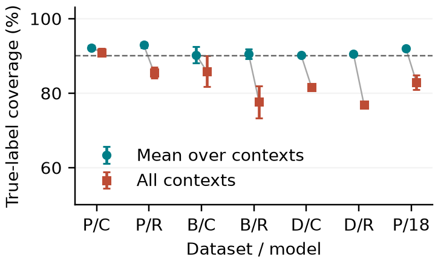

# Same Image, Different Coverage

A reproducible companion-context audit of prediction-time batch normalization in medical image classifiers. Research manuscript by Shivam Gupta. The author has confirmed review, responsibility, affiliation, eligibility, and submission declarations. No submission or acceptance is claimed. The four-page PDF uses the official IEEE ISBI template and includes ethics, funding, conflict-of-interest, and AI-assistance statements.

The empirical question is whether true-label inclusion for one unchanged query persists across a fixed menu of batch companions. The audit compares nominal calibration, context-specific calibration, Bonferroni, Corrected Max-Rank (Schlembach et al., 2026), and existing maximum-score calibration. It does not introduce these established conformal methods.

Read the [four-page manuscript](paper/main.pdf), [focused novelty review](NOVELTY_REVIEW.md), and [scientific review notes](REVIEW_NOTES.txt).

On the compact PneumoniaMNIST residual models, context-specific calibration gives 92.9% mean coverage but 85.5% simultaneous coverage. Corrected Max-Rank gives 96.6% simultaneous coverage at mean deployed set size 1.68. These are five-seed benchmark averages, not clinical validation.



## Reproduce

Python 3.12 was used. `requirements-lock.txt` records the exact executed environment. The primary experiments train on CPU with two threads; the higher-resolution extension originally trains on MPS. Apple MPS accelerates inference on the original machine; replace `mps` by `cpu` elsewhere. CPU replay is checked against saved MPS probabilities with an explicit numerical tolerance.

```sh
python -m venv .venv
.venv/bin/python -m pip install -r requirements-lock.txt
.venv/bin/python src/download_data.py
.venv/bin/python src/audit_final_data.py
.venv/bin/python src/test_correctness.py
.venv/bin/python src/run.py --modes source target --conditions clean --inference-device cpu
.venv/bin/python src/run.py --archs cnn_bn resnet_bn --seeds 0 --modes source target mixed first --conditions clean affine --inference-device cpu
.venv/bin/python src/run.py --archs cnn_bn --seeds 0 --modes target --conditions clean --batch 8 --inference-device cpu
.venv/bin/python src/run.py --archs cnn_bn --seeds 0 --modes target --conditions clean --batch 32 --inference-device cpu
.venv/bin/python src/download_highres.py
.venv/bin/python src/run_highres.py --device cpu
.venv/bin/python src/analyze_highres.py
.venv/bin/python src/analyze.py
.venv/bin/python src/validation_pool.py --device cpu
.venv/bin/python src/additional_analysis.py
.venv/bin/python src/score_sensitivity.py
.venv/bin/python src/report.py
.venv/bin/python src/verify_saved.py
.venv/bin/python src/verify_highres.py
(cd paper && tectonic main.tex)
```

After installing dependencies and Tectonic, `RESEARCH_PYTHON=.venv/bin/python ./rebuild_report.sh` rebuilds the manuscript from the archived predictions without source images or training. Tectonic must be installed separately and fetches its LaTeX bundle on first compilation.

To reproduce summaries and figures without retraining, use the released `results/` probability files and run `analyze.py`, `analyze_highres.py`, `additional_analysis.py`, `score_sensitivity.py`, and `report.py` (validation-pool summaries are already included). A fresh training reproduction should start with empty `results/` and `results_highres/` directories after backing up the released outputs: the training runner reuses checkpoints and probabilities already present. Do not reuse the cache after changing data, model code, training options, or preprocessing. The primary run consists of 45 models, each with 25 epochs; a secondary extension fine-tunes five ImageNet-pretrained ResNet18 models at 224 pixels for five epochs each. Resource requirements are modest but the complete run takes substantial time. Exact floating-point agreement across hardware is not assumed.

Run `src/validate_release.py` to check the complete saved release without source images. SHA256SUMS records hashes of the archived files. Regeneration can change PDF timestamps; these hashes identify the released version.

## Artifact map

- `paper/main.tex`, bibliography, official `spconf.sty`/`IEEEbib.bst`, generated tables and vector figures: manuscript source.
- `src/models.py`: explicit query-group BN implementation; source, current-group, 50:50 moment mixture, first-layer-only controls; CNN and compact residual models; GroupNorm control.
- `src/run.py`: training, validation checkpoint selection, fixed companion menus, isolated query/context inference, saved probabilities.
- `src/conformal.py`: finite-sample corrected thresholds; maximum-tie rank handling; infinity boundary; deployed-set and intersection metrics.
- `src/test_correctness.py`: implementation and finite-sample property checks.
- `src/analyze.py`, `src/report.py`: results recomputed from probabilities, 100 dependent split-sensitivity trials, conditional query bootstrap, tables and figures.
- `src/verify_saved.py`, `src/verify_highres.py`: CPU replay from released checkpoints and checksums. `src/validate_release.py` checks all archived probability arrays and release completeness.
- `results/*/training.json`: full epoch histories. `model.pt`: validation-selected weights. `p_*.npz`: probabilities `[context, held-out image, class]`, labels, calibration/evaluation indices and companion indices. `indices_b*.npz` and `contexts_b*.json`: exact menu metadata. Infinite thresholds are encoded as the string `"Infinity"` in JSON metadata; numerical calibration uses floating-point infinity.
- `results/all_metrics.csv`, `summary.csv`, `paired_bootstrap.csv`, `split_sensitivity.csv`, `class_metrics.csv`, `held_out_menu.csv`, `score_sensitivity.csv`: machine-readable analysis. Accuracy/AUC fields use the first natural context (or source statistics), rather than averaging stress-context accuracy.
- `PROTOCOL.md`: exploratory protocol and amendments; not a preregistration.
- `THEORY.md`: exact guarantee scope, deployment-cost distinction, CMR mapping, and conservative tie-handling argument.
- `src/additional_analysis.py`, `src/score_sensitivity.py`: per-class, held-out-menu, and deterministic/randomized APS sensitivity. Shared per-query uniforms preserve the paired context intervention; all are exploratory diagnostics.
- `NOVELTY_REVIEW.md`: nearest work, overlap boundaries, and rejected directions.

## Data integrity and permitted use

PneumoniaMNIST and BreastMNIST are downloaded from the official MedMNIST releases and checked against upstream MD5 and SHA-256. Exact-byte duplicate removal gives training > validation > test priority. Dermatology uses published DermaMNIST-C, with a pinned upstream commit and SHA-256. Its corrected metadata are checked against every label, lesion sets are disjoint across partitions, and the first retained test image per lesion is selected without consulting diagnoses. Final retained indices and archive checksums are released. The original DermaMNIST archive is not used by the final experiments.

The original images and third-party papers are not redistributed. PneumoniaMNIST and BreastMNIST are listed as CC BY 4.0; dermatology data are CC BY-NC 4.0. Respect original dataset attribution and use restrictions. Weights trained on dermatology are supplied for noncommercial research only, subject to the source data terms; no clinical or commercial data-use clearance is asserted. Data use licenses do not by themselves resolve institutional ethics requirements.

## Interpretation

The simultaneous event is true-label inclusion under all fixed menu contexts for the same query. It is different from average context coverage, each context's marginal coverage, or simultaneous coverage of different patients. Maximum-score and CMR guarantees require exchangeability and a fixed scoring procedure/menu independent of calibration/evaluation data. A realized finite evaluation split can fall below the nominal target. The guarantee does not cover new contexts, arbitrary batch compositions, model updates, patient-level validity without suitable sampling, rare-class conditional coverage, or external distribution shift.

The menus are controlled stress tests built using training labels, not a claim about realistic prevalence or a deployed label-aware scheduler. Primary results use compact networks and 28-pixel benchmarks; the separate pretrained extension uses 224-pixel radiographs. The paired bootstrap resamples queries, conditional on the fitted models and calibration sets. Seeds, contexts, and repeated splits must not be treated as independent patients. Commercial motivation is quality assurance of inference scheduling; clinical efficacy, patentability, and regulatory compliance have not been established.

## Higher-resolution extension

`src/run_highres.py` fine-tunes official Torchvision ResNet18 IMAGENET1K_V1 weights on 224-pixel PneumoniaMNIST, with five training seeds, five epochs, AdamW learning rate/weight decay 1e-4, batch 32, no augmentation, and validation-NLL checkpoint selection. Training and inference originally use Apple MPS. Source image indices first follow 28-pixel cleaning and receive an additional 224-pixel byte audit. The 224 archive label ordering is checked against the 28-pixel release. Grayscale images are repeated across RGB and ImageNet-normalized. All 12 companion contexts and five conformal comparators are retained. This is a secondary extension with a different training protocol, not a controlled causal comparison of architecture or resolution. `results_highres/` stores weights, histories, predictions, summaries, retained indices, and provenance. The upstream ImageNet weight SHA-256 is f37072fd47e89c5e827621c5baffa7500819f7896bbacec160b1a16c560e07ec; source data/weight terms remain applicable. It is not a medical foundation model or a diagnostic-resolution clinical validation.
